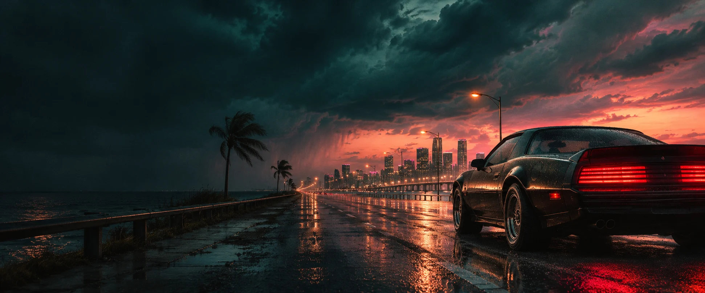

# LEONIDA

**[Play the live coastal drive ↗](https://bitovvnew.github.io/leonida/)**



**Xbox Edition for PC · Winter project preview · December 22, 2026**

A storm has just passed over the causeway. Across the water, the first lights are coming on. LEONIDA’s winter preview takes you from the waterfront to the tidal keys in an original **1.8 km browser drive**.

### Play

Download the project folder and open **index.html**. Choose **Play coastal drive**, then hold the arrow keys or touch controls to steer. Leaving the pavement slows the coupe. Reach the keys for a finish time, or pause and resume along the way. The full site runs offline.

### Xbox Edition for PC

LEONIDA is an independent GTA VI fan project pursuing an Xbox-inspired Windows edition. The winter countdown belongs to the project preview. Windows executable availability and native performance results will be announced separately. [Edition dossier](docs/xbox-edition.md)


### Inside the project

| Path | Responsibility |
| --- | --- |
| [src/Site.tsx](src/Site.tsx) | Static React campaign page |
| [src/components](src/components/) | Accessible drive dialog |
| [src/drive](src/drive/) | Road projection, steering, timing and replay |
| [src/edition.ts](src/edition.ts) | Shared release date and course length |
| [viewer/campaign.css](viewer/campaign.css) | Responsive layout and typography |
| [assets](assets/) | Original campaign artwork |
| [runtime](runtime/) | Compiled browser JavaScript |
| [scripts](scripts/) | Static build and offline release checks |

### Build from source

Use Node.js with npm and Python 3. Run these commands in this folder.

```sh
npm install
npm run build
npm run check
```

The build produces index.html and runtime/preview.js. Both ship with the project, so visitors can open the release directly.

Independent fan project, unaffiliated with Rockstar Games, Take-Two Interactive or Microsoft.
